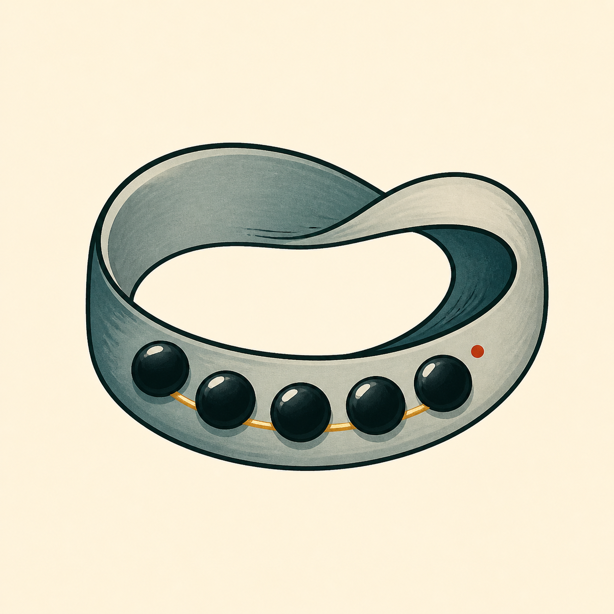
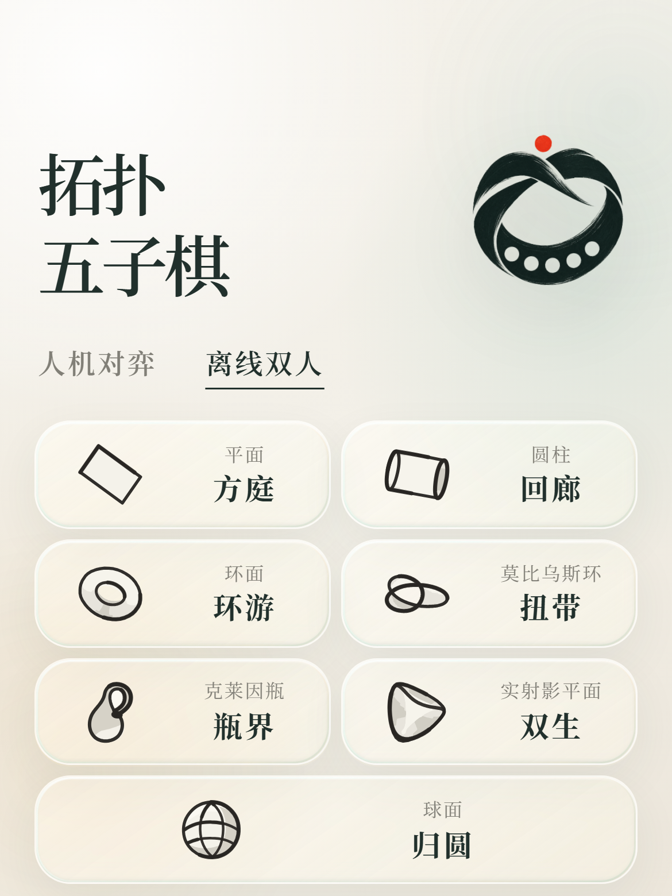
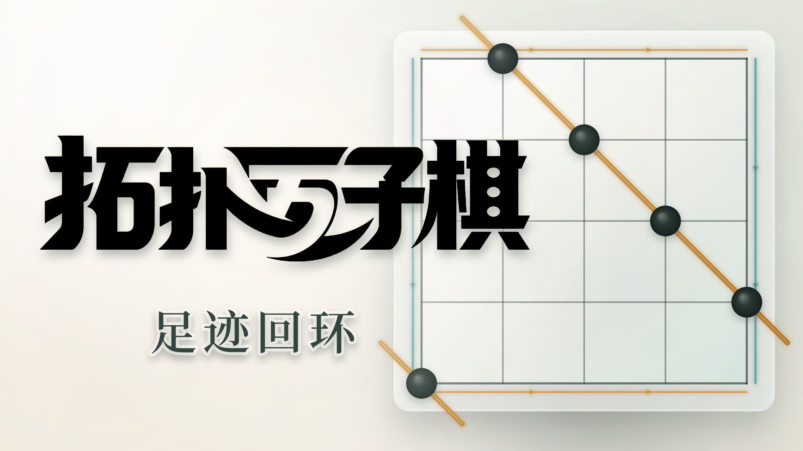

<div align="center">
  
  <h1>拓扑五子棋</h1>
  <p><strong>边界之外，也能连成一线。</strong></p>
  <p>
    
    <a href="CONTRIBUTING.md"></a>
    <a href="LICENSE"></a>
  </p>
  <p>
    
    
    
  </p>
  <p>一个把五子棋放进圆柱、莫比乌斯带、环面与克莱因瓶的小游戏。</p>
  <p>原作者：<a href="https://www.yykspace.com/">余荫铠</a></p>
  
  <p><sub>游戏首页 · 离线双人模式</sub></p>
  <p>
    <a href="https://www.bilibili.com/video/BV16stL6JExU/">
      
    </a>
  </p>
  <p><a href="https://www.bilibili.com/video/BV16stL6JExU/">点击观看 · 章节预告 PV「足迹回环」</a></p>
</div>

## 熟悉的五子棋，陌生的世界

在这里，棋盘的边缘不是尽头。

棋子可以从右侧走回左侧，沿着莫比乌斯带翻转方向，或绕过环面的背面重新出现。单人模式的第一关每次进入都会请你亲手逐颗完成基础五连；其余关卡首次游玩时，也会请你亲手下出一至两条跨界五连，重玩时再用短动画温习。从第二关起，对局中还可以随时轻触“边界演示”，重新体验本关的全部指引线路，或拖动二维/三维视角进度，在对局中慢慢观察拓扑变化；这些查看操作不会改变棋局，结束后继续原来的棋局。

单人模式也允许通过封锁通关。当你已经截断对手全部可能的五连路径，对局会立即结束。小棋盘不再需要无意义地填满，每一步都在改变整个空间的可能性。

## 七个世界，一段旅程

| 世界 | 拓扑 | 边界之外 |
| --- | --- | --- |
| 方庭 | 平面 | 从最熟悉的五子棋开始 |
| 回廊 | 圆柱 | 左右两侧首尾相接 |
| 环游 | 环面 | 横向与纵向都没有尽头 |
| 扭带 | 莫比乌斯带 | 穿过接缝后，世界翻转 |
| 瓶界 | 克莱因瓶 | 一次环绕会改变前进的方向 |
| 双生 | 实射影平面 | 对面的边与倒影相连 |
| 归圆 | 球面 | 所有边界最终消失 |

通关时，棋盘会从当前的展开程度与观察角度，带着真实落子与获胜路径连续进入三维展示；球面的网格调整也保持连续。你可以拖动它、让它旋转，从另一个角度看见刚才那条不可能的五连。棋盘下方的细轨道支持连续拖动，两端“二维”“三维”可一键切换；键盘方向键微调，Home / End 直达两端。

## 一册可以游玩的拓扑图鉴

尚未通关的世界只留下神秘剪影。真正赢下一局之后，完整的几何体才会显现。七个关卡既是一段逐渐离开平面的旅程，也是一册由你亲手解锁的拓扑图鉴。

游戏完全离线运行，没有账号、广告或联网请求。进度保存在设备上，单人模式内置三档本地对手，也可以选择离线双人模式，在同一台设备上轮流操作黑白双方。

在首页选择“离线双人”即可直接进入全部七个关卡，无需解锁，黑方先行，每次合法落子后交给另一方。双人局直接开局，双方均以五连获胜，满盘且没有五连时和局；单人的封锁通关规则不适用于双人局。悔棋撤回最后一手，重来恢复黑方先行，终局可以复盘、再来或返回旅程。从第二关起仍可主动查看边界演示，完成指引后恢复原棋盘与执棋方。双人胜局和和局沿用旅程解锁，但不记作 AI 难度成绩。

## 活动与荣誉

- 小红书 VibeCoding 大赛：人文知识赛道入围并获奖，决赛正在进行。
- 小红书国风 VibeCoding 大赏：获得「Vibe 国风潜力奖」。
- 原神千星奇域：入选原神官方「绮衣赏珍·晴暖」活动关卡。
- 知乎 AI Works 科学季：登上「最热」项目首位。
- Bilibili Toy：全站游戏榜 Top 100。

## 在哪里玩

| 平台 | 游玩入口 |
| --- | --- |
| 小红书 | [小工具·拓扑五子棋](https://www.xiaohongshu.com/s/poster?bgimg=https%3A%2F%2Fsns-redskillhub-s1.xhscdn.com%2Fred_app_image%2F1040g4m8326i89vkp4q005on8i5f7qmruthk9v10%3Fsign%3D76b351ad52de1e1fb4bb4586473c375c%26t%3D6cb8d1bf&deeplink=xhsdiscover%3A%2F%2FminiTool%2F6a8f70ebe29cdb0015d5b744%3Fsource%3Dh5%26page_key%3D28%26xhsMpScreenMode%3Dfull) |
| Bilibili Toy | [拓扑五子棋](https://www.bilibili.com/toy/topology-gomoku/index.html) |
| 微信 | 在微信小程序中搜索「拓扑五子棋」 |
| Web | [直接在浏览器中游玩](https://www.yykspace.com/show/topology-gomoku/) |
| 知乎 AI Works | [知乎作品页](https://www.zhihu.com/project/detail/180488) · [直接游玩](https://4ud8bsupy79l.aiworks.site/) |

### 原神千星奇域

千星奇域版由社区创作者**嘟嘟可**制作，原神 UID：`170427528`。你也可以在 [B站「神奇嘟嘟可」](https://space.bilibili.com/233587917)和 [GitHub @1475505](https://github.com/1475505)找到这位创作者。

在原神千星奇域中，可通过以下 GUID 查找关卡：

| 关卡名 | GUID |
| --- | --- |
| 拓扑五子棋 | `127344607235` |
| 拓扑五子棋-双人对弈 | `131639574531` |

## 社区的另一种玩法

社区创作者也在这张棋盘上加入了自己的想法：

- [联机版](https://topology-gomoku.qqs.tw)：社区二次开发的联机版本。
- [中秋版](https://moon-gomoku.qqs.tw)：社区二次开发的中秋主题版本。

欢迎体验这些作品，也欢迎分享你的版本。

## 把你的想法放上棋盘

欢迎一起让拓扑五子棋变得更有趣。无论是带着自己的想法，还是想从一个小改进开始，都可以把下面这段话直接发给你常用的 AI 编程助手：

```text
请帮我参与开源项目“拓扑五子棋”：https://github.com/YinkaiYu/topology-gomoku 。请帮我选择一个范围清晰的 Issue 或小创意，和我一起确定要改进的内容，再完成改进并展示成果，让我体验并提出反馈。
```

如果已有想法，也欢迎在后面补充你期待的玩法、遇到的问题或希望改善的体验。每一个小改进都值得参与。

<div align="center">
  <p>以 MIT License 开放。</p>
  <sub>Made for people who look at an edge and wonder what happens on the other side.</sub>
</div>
